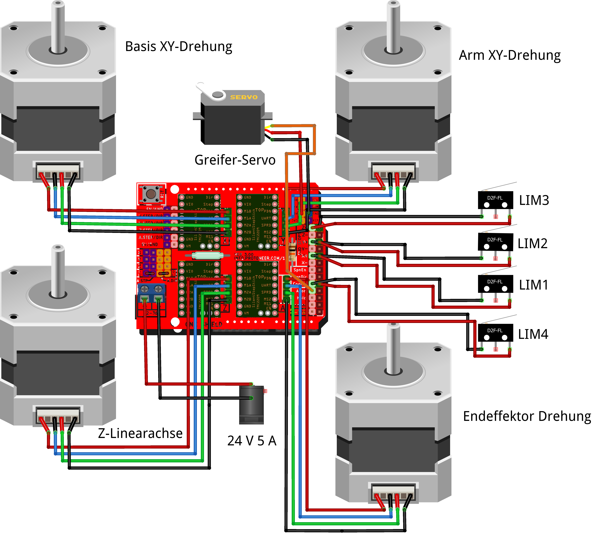

## Entwurf-und-Fertigung-von-Flachbaugruppen-SCARA
 
Dieses Repository ist Teil des Modules **IE-M13-3054** der Studierenden **Dejan Dimitrijević**, **Alexander Klose** und **Jakob Cap** an der [**Hochschule für Wirtschaft und Recht (HWR) Berlin**](https://www.hwr-berlin.de/).

## Inhaltsverzeichnis
* [Grundlegende Informationen](#grundlegende-informationen)
* [Repository-Struktur](#repository-struktur)
* [Idee hinter dem Projekt](#idee-hinter-dem-projekt)
* [Schaltplanentwicklung](#schaltplanentwicklung)
* [Prototypenentwicklung](#prototypenentwicklung)
* [Finales PCB-Design](#finales-pcb-design)
 
## Grundlegende Informationen
 
Dieses GitHub-Repository befasst sich mit der Entwicklung und Fertigung eines PCBs für einen SCARA-Roboter, welcher im Rahmen des Moduls **IE-M26-6045** von den Studierenden **Jakob Cap** und **David Kowalczyk** entwickelt wurde. Der SCARA-Roboter DJ01 ist im Nachfolgenden Bild zu sehen.

<p align="center">

</p>

## Repository-Struktur
 
```
├── sw/
│   └── Code/              	   # Programmcode des SCARA-Roboters DJ01
├── proj/
│   ├── Easy EDA/              # Easy EDA Projekt der PCBs inklusive Schaltplan und PCB Layout
│       ├── Prototyp/          # Easy EDA Projekt des ersten Prototyps
│       └── Finales Design/    # Easy EDA Projekt des finales Designs
│   ├── Schaltplan/            # Schaltpläne der PCBs
│       ├── Prototyp/          # Schaltplan des ersten Prototyps
│       └── Finales Design/    # Schaltplan des finales Designs
│   └── Export/                # Exportierte Dateien (Gerber, BOM, Pick-and-Place, etc.) für die Fertigung des PCBs
│       ├── Prototyp/          # Exportierte Dateien des ersten Prototyps
│       └── Finales Design/    # Exportierte Dateien des finales Designs
├── docs/
│   ├── 3D-Design/             # 3D Dateien und technische Zeichnungen
│   ├── Datenblätter/          # Datenblätter der Komponenten
│   ├── Pinouts/               # Pinouts der Komponenten
│   ├── Lastenheft/            # Lastenheft des SCARA-Roboters DJ01
│   ├── Bestandsschaltplan/    # Bestandsschaltplan des SCARA-Roboters DJ01
│   ├── Bauanleitung/          # Bauanleitung des SCARA-Roboters DJ01
│   └── Ablaufdiagramm/        # Ablaufdiagramm des Programmcodes
├── Abgabe Konstruktionslehre/ # Ausarbeitung für das Modul Konstruktionslehre
├── Images/                    # Bilder für die README.md
└── README.md
```
## Idee hinter dem Projekt

Die Idee hinter dem Projekt ist es, ein PCB für den SCARA-Roboter DJ01 zu entwickeln, dass die ursprüngliche verwendete Steuerungseinheit ersetzt. Aktuell erfolgt die Ansteuerung der NEMA 11 und NEMA 17 Schrittmotoren sowie des Servomotors über ein ESPDuino32-Board. Dieses ESPDuino32-Board ist mit einem CNC-Shield V3 verbunden, auf welchem vier [`TMC2209`](docs/Datenblaetter/tmc2209_datasheet_rev1.09.pdf) Schrittmotortreiber eingesteckt sind. Zudem werden über das CNC-Shield der Servomotor des Greifers angesteuert sowie die vier Endlagenschalter ausgelesen. Eine schematische Darstellung des aktuellen Aufbaus ist in der nachfolgenden Abbildung zu sehen.

<p align="center">

</p>

Da das CNC-Schield keine Anschlüsse für die DIAG-Pins der TMC2209 Schrittmotortreiber bietet, ist es nicht möglich, die Fehlerzustände der Schrittmotortreiber auszulesen und ein Sensorloses Homing der Motoren zu implementieren. Zudem muss das CNC-Shield und der ESPDuino32 über zwei separate Spannungsquellen versorgt werden, was den Aufbau unnötig verkompliziert.

Ziel dieses Projektes ist es daher, ein PCB zu entwickeln, welches in der Lage ist die vier TMC2209 Schrittmotortreiber sowie den Servomotor anzusteuern und über die Verwendung der DIAG-Pins ein Sensorloses Homing der Motoren zu ermöglichen. Zeitgleich soll die Stromversorgung des gesamten Roboters nur noch über ein einzelnes 24 V DC-Netzteil erfolgen. Die genaue Auflistung der funktionalen und nicht funktionalen Anforderungen kann dem [`Lastenheft`](docs/Lastenheft/SCARA_PCB_Lastenheft.pdf) entnommen werden.

## Prototypenentwicklung

Auf Grundlage der im Abschnitt [`Idee hinter dem Projekt`](#idee-hinter-dem-projekt) beschriebenen Anforderungen wurde ein erster Prototyp des PCBs entwickelt. Zunächst wurde das Design in **Altium Designer** begonnen. Dabei zeigte sich jedoch, dass die Lernkurve sehr steil ist und die Einarbeitung im Rahmen des Projekts zu viel Zeit in Anspruch genommen hätte. Aus diesem Grund fiel die Entscheidung auf **EasyEDA**. **EasyEDA** ermöglicht über die eigene Browseranwendung eine effiziente Zusammenarbeit, was die Zusammenarbeit im Team deutlich vereinfacht hat. Zudem sind alle Komponenten des elektronik Lieferanten **JCSC** nativ in EasyEDA eingebunden, was die Komponentensuche und die endgültige Bestellung deutlich erleichtert. Der erste Prototyp wurde daher in **EasyEDA** entworfen und anschließend über den Hersteller **JLCPCB** gefertigt. Die Entwicklung dieses Prototyps ist in den nachfolgenden Abschnitten beschrieben.

### Schaltplanentwicklung

Die Entwicklung des Schaltplans erfolgte auf Grundlage der im Abschnitt [`Idee hinter dem Projekt`](#idee-hinter-dem-projekt) beschriebenen Anforderungen. Ziel war es, die vier bestehenden TMC2209 Schrittmotortreiber über Steckplätze auf dem PCB zu befestigen. Die Motorkabel der Schrittmotoren und des Servomotors sollten über Steckverbinder auf dem PCB angeschlossen werden. Aufgrund seiner großen Abmessungen sollte der aktuell verwendete ESPDuino32 durch ein kleineres ESP32-DevkitC ersetzt werden. Zudem sollte die Spannungsversorgung des Gesamten Roboters über ein 24 V DC-Netzteil bzw. einen 24 V DC-Power-Jack erfolgen. Da der Mikrocontroller und der Servomotor eine Versorgungsspannung von 5 V benötigen, müssen die 24 V des Netzteils mittels eines DC/DC-Wandlers auf 5 V transformiert werden. Die 3,3 V Versorgungsspannung der TMC2209 Treiber wird über den 3,3 V Pin des ESP32-Devkits bereitgestellt.

All diese Überlegungen mussten im Schaltplan des ersten Prototypen umgesetzt werden. Der finale [`Schaltplan des ersten Prototypen`](proj/Schaltplan/Prototyp/) ist 

### PCB-Layout


### Bestückung und Fertigung

### Erkenntnisse und Fehlerbehebung

## Finales PCB-Design

### Änderungen des Schaltplans

### Änderungen des PCB-Layouts

### Bestückung und Fertigung

