## Entwurf-und-Fertigung-von-Flachbaugruppen-SCARA
 
Dieses Repository ist Teil des Modules **IE-M13-3054** der Studierenden **Dejan Dimitrijević**, **Alexander Klose** und **Jakob Cap** an der [**Hochschule für Wirtschaft und Recht (HWR) Berlin**](https://www.hwr-berlin.de/).


## Inhaltsverzeichnis

* [Grundlegende Informationen](#grundlegende-informationen)
* [Repository-Struktur](#repository-struktur)
* [Idee hinter dem Projekt](#idee-hinter-dem-projekt)
* [Prototypenentwicklung](#prototypenentwicklung)
    * [Schaltplanentwicklung](#schaltplanentwicklung)
    * [PCB-Layout](#pcb-layout)
    * [Bestückung und Fertigung](#bestückung-und-fertigung)
    * [Testversuche](#testversuche)
* [Finales PCB-Design](#finales-pcb-design)
    * [Änderungen des Schaltplans](#änderungen-des-schaltplans)
    * [Änderungen des PCB-Layouts](#änderungen-des-pcb-layouts)
    * [Bestückung und Fertigung](#bestückung-und-fertigung-1)
* [Erkenntnisse und Learnings](#erkenntnisse-und-learnings)

 
## Grundlegende Informationen
 
Dieses GitHub-Repository befasst sich mit der Entwicklung und Fertigung eines PCBs für einen SCARA-Roboter, welcher im Rahmen des Moduls **IE-M26-6045** von den Studierenden **Jakob Cap** und **David Kowalczyk** entwickelt wurde. Der SCARA-Roboter DJ01 ist im Nachfolgenden Bild zu sehen.

<p align="center">

</p>

## Repository-Struktur
 
```
├── sw/
│   └── Code/              	   # Programmcode des SCARA-Roboters DJ01
├── proj/
│   ├── Easy EDA/              # Easy EDA Projekt der PCBs inklusive Schaltplan und PCB Layout
│       ├── Prototyp/          # Easy EDA Projekt des ersten Prototyps
│       └── Finales Design/    # Easy EDA Projekt des finales Designs
│   ├── Schaltplan/            # Schaltpläne der PCBs
│       ├── Prototyp/          # Schaltplan des ersten Prototyps
│       └── Finales Design/    # Schaltplan des finales Designs
│   └── Export/                # Exportierte Dateien (Gerber, BOM, Pick-and-Place, etc.) für die Fertigung des PCBs
│       ├── Prototyp/          # Exportierte Dateien des ersten Prototyps
│       └── Finales Design/    # Exportierte Dateien des finales Designs
├── docs/
│   ├── 3D-Design/             # 3D Dateien und technische Zeichnungen
│   ├── Datenblätter/          # Datenblätter der Komponenten
│   ├── Pinouts/               # Pinouts der Komponenten
│   ├── Lastenheft/            # Lastenheft des SCARA-Roboters DJ01
│   ├── Bestandsschaltplan/    # Bestandsschaltplan des SCARA-Roboters DJ01
│   ├── Bauanleitung/          # Bauanleitung des SCARA-Roboters DJ01
│   └── Ablaufdiagramm/        # Ablaufdiagramm des Programmcodes
├── Abgabe Konstruktionslehre/ # Ausarbeitung für das Modul Konstruktionslehre
├── images/                    # Bilder für die README.md
└── README.md
```
## Idee hinter dem Projekt

Die Idee hinter dem Projekt ist es, ein PCB für den SCARA-Roboter DJ01 zu entwickeln, dass die ursprüngliche verwendete Steuerungseinheit ersetzt. Aktuell erfolgt die Ansteuerung der NEMA 11 und NEMA 17 Schrittmotoren sowie des Servomotors über ein ESPDuino32-Board. Dieses ESPDuino32-Board ist mit einem CNC-Shield V3 verbunden, auf welchem vier [`TMC2209`](docs/Datenblaetter/tmc2209_datasheet_rev1.09.pdf) Schrittmotortreiber eingesteckt sind. Zudem werden über das CNC-Shield der Servomotor des Greifers angesteuert sowie die vier Endlagenschalter ausgelesen. Eine schematische Darstellung des aktuellen Aufbaus ist in der nachfolgenden Abbildung zu sehen.

<p align="center">

</p>

Da das CNC-Schield keine Anschlüsse für die DIAG-Pins der TMC2209 Schrittmotortreiber bietet, ist es nicht möglich, die Fehlerzustände der Schrittmotortreiber auszulesen und ein Sensorloses Homing der Motoren zu implementieren. Zudem muss das CNC-Shield und der ESPDuino32 über zwei separate Spannungsquellen versorgt werden, was den Aufbau unnötig verkompliziert.

Ziel dieses Projektes ist es daher, ein PCB zu entwickeln, welches in der Lage ist die vier TMC2209 Schrittmotortreiber sowie den Servomotor anzusteuern und über die Verwendung der DIAG-Pins ein Sensorloses Homing der Motoren zu ermöglichen. Zeitgleich soll die Stromversorgung des gesamten Roboters nur noch über ein einzelnes 24 V DC-Netzteil erfolgen. Die genaue Auflistung der funktionalen und nicht funktionalen Anforderungen kann dem [`Lastenheft`](docs/Lastenheft/SCARA_PCB_Lastenheft.pdf) entnommen werden.

## Prototypenentwicklung

Auf Grundlage der im Abschnitt [`Idee hinter dem Projekt`](#idee-hinter-dem-projekt) beschriebenen Anforderungen wurde ein erster Prototyp des PCBs entwickelt. Zunächst wurde das Design in **Altium Designer** begonnen. Dabei zeigte sich jedoch, dass die Lernkurve sehr steil ist und die Einarbeitung im Rahmen des Projekts zu viel Zeit in Anspruch genommen hätte. Aus diesem Grund fiel die Entscheidung auf **EasyEDA**. **EasyEDA** ermöglicht über die eigene Browseranwendung eine effiziente Zusammenarbeit, was die Zusammenarbeit im Team deutlich vereinfacht hat. Zudem sind alle Komponenten des elektronik Lieferanten **JCSC** nativ in EasyEDA eingebunden, was die Komponentensuche und die endgültige Bestellung deutlich erleichtert. Der erste Prototyp wurde daher in **EasyEDA** entworfen und anschließend über den Hersteller **JLCPCB** gefertigt. Die Entwicklung dieses Prototyps ist in den nachfolgenden Abschnitten beschrieben.

### Schaltplanentwicklung
 
Die Entwicklung des Schaltplans erfolgte auf Grundlage der im Abschnitt [`Idee hinter dem Projekt`](#idee-hinter-dem-projekt) beschriebenen Anforderungen. Ziel war es, die vier bestehenden TMC2209-Schrittmotortreiber über Steckplätze auf dem PCB zu befestigen. Die Motorkabel der Schrittmotoren und des Servomotors sollten über Steckverbinder auf dem PCB angeschlossen werden. Aufgrund seiner großen Abmessungen sollte der aktuell verwendete ESPDuino32 durch ein kleineres ESP32-DevkitC ersetzt werden. Zudem sollte die Spannungsversorgung des gesamten Roboters über ein 24-V-DC-Netzteil bzw. einen 24-V-DC-Power-Jack erfolgen. Da der Mikrocontroller und der Servomotor eine Versorgungsspannung von 5 V benötigen, müssen die 24 V des Netzteils mittels eines DC/DC-Wandlers auf 5 V transformiert werden. Die 3,3-V-Versorgungsspannung der TMC2209-Treiber wird über den 3,3-V-Pin des ESP32-Devkits bereitgestellt. All diese Überlegungen mussten im Schaltplan des ersten Prototypen umgesetzt werden.
 
Die erste Komponente des Schaltplans ist der 24-V-DC-Power-Jack (`DC1`), welcher die Spannungsversorgung des gesamten Roboters übernimmt. Die 24-V-Ausgangsspannung des Power-Jacks wird mittels eines 100-µF-Elektrolytkondensators (`C5`) gegen GND stabilisiert.
 
<p align="center">
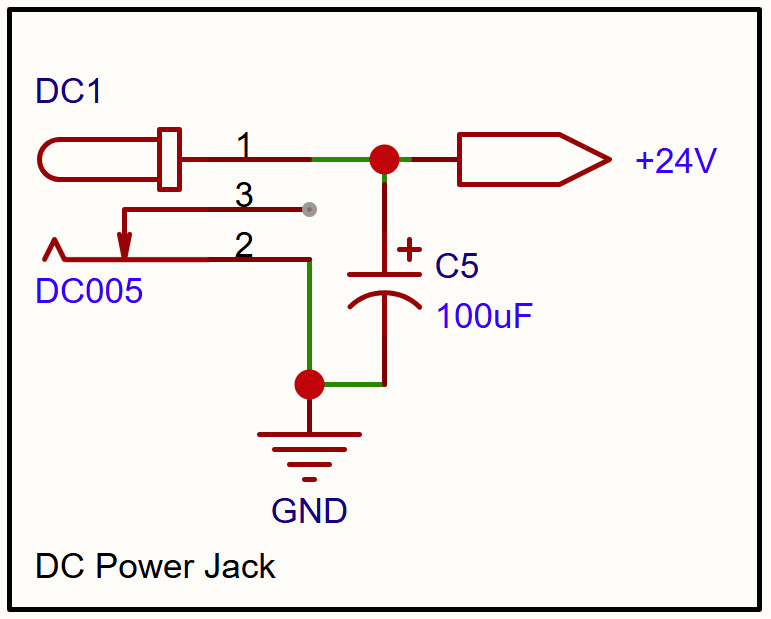
</p>

Nach dem Kondensator wird die 24-V-Spannung über eine DC-DC-Converter-Schaltung auf 5 V transformiert. Die Schaltung besteht aus dem eigentlichen DC-DC-Wandler (`U7`) sowie zahlreichen Widerständen (`R5-R10`), Kondensatoren (`C7-C9`), einer Diode (`D1`) und einer Spule (`L1`). Die Schaltung wurde anhand des [`Datenblattes des DC-DC-Wandlers`](docs/Datenblaetter/24Vto5V.pdf) gestaltet und nachgebaut.
 
<p align="center">
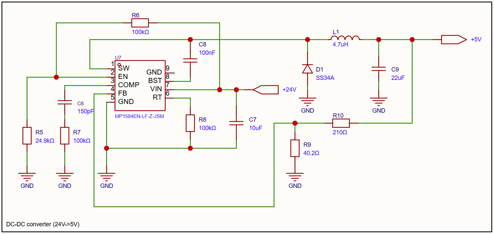
</p>

Die 5-V-Ausgangsspannung der DC-DC-Converter-Schaltung wird an das ESP32-Devkit sowie den Servomotor weitergegeben. Das ESP32-Devkit wird mittels zweier 15-poliger Steckverbinder (`H21` und `H22`) auf dem PCB befestigt. Die 5-V-Ausgangsspannung des DC-DC-Wandlers ist dabei mit Pin 15 des Headers `H21` verbunden. Über die weiteren Pins der beiden Header werden die verschiedenen Steuersignale der Schrittmotoren und des Servomotors ausgegeben bzw. die Rückmeldesignale eingelesen. Jeder TMC2209-Treiber verfügt über ein eigenes `DIAG_Tx`-Signal, ein `STEP_Tx`-Signal und ein `DIR_Tx`-Signal. Zudem sind alle Treiber an das Signal `EN`, welches für die Aktivierung bzw. Deaktivierung der Treiber verwendet wird, und die UART-Leitungen `TX0` und `RX0` angeschlossen.
 
 
<p align="center">
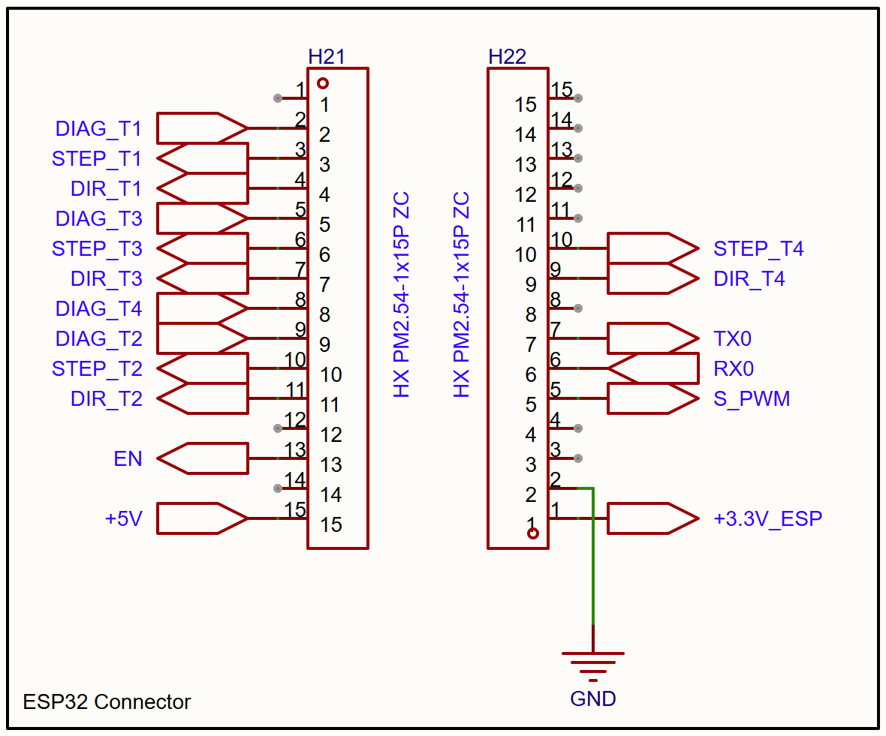
</p>

Die vier TMC2209-Treiber selbst werden jeweils mittels dreier Steckverbinder auf dem PCB befestigt. Dafür werden pro Treiber ein 2-poliger Steckverbinder (`H2`, `H7`, `H12` und `H17`) sowie zwei 8-polige Steckverbinder (`H1`, `H3`, `H6`, `H8`, `H11`, `H13`, `H16` und `H18`) verwendet. Über die Elektrolytkondensatoren `C1`, `C2`, `C3` und `C4` wird die 24-V-Versorgungsspannung der Schrittmotoren stabilisiert. Die Treiber selbst erhalten ihre 3,3-V-Versorgungsspannung über den 3,3-V-Pin des ESP32-Devkits. Die Motorkabel der Schrittmotoren werden über die 4-poligen Stecker `CN1` bis `CN4` an das PCB angeschlossen. 
 
<p align="center">
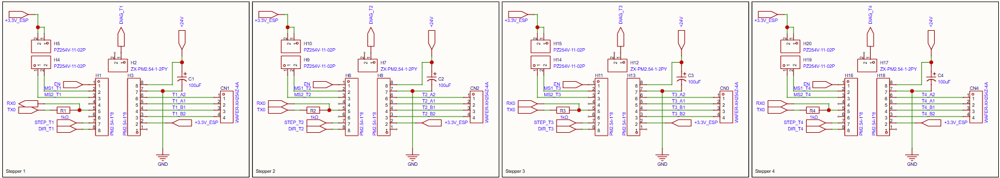
</p>

In der detaillierteren Ansicht des Steckplatzes für den Treiber T1 ist zudem zu erkennen, dass die UART-Leitungen `TX0` und `RX0` des ESP32 nicht direkt an die Treiber angeschlossen werden. `TX0` wird über die 1-kΩ-Widerstände (`R1` bis `R4`) mit der `RX0`-Leitung verbunden. Diese gebündelte Leitung wird anschließend an die Treiber angeschlossen. Über die Header `H4`, `H5`, `H9`, `H10`, `H14`, `H15`, `H19` und `H20` können die UART-Adressen der einzelnen Treiber eingestellt werden. Über Verbindungsbrücken zwischen den einzelnen Pins können die `MS1`-Pins und `MS2`-Pins der Treiber entweder mit GND oder 3,3 V verbunden werden. Die so einstellbaren Adressen sind in der folgenden Tabelle dargestellt. 
 
<p align="center">

| MS2 | MS1 | UART-Adresse des Treibers |
|:---:|:---:|:---:|
| `GND` | `GND` | 0x00 |
| `GND` | `3,3 V` | 0x01 |
| `3,3 V` | `GND` | 0x02 |
| `3,3 V` | `3,3 V` | 0x03 |
 
</p>

<p align="center">
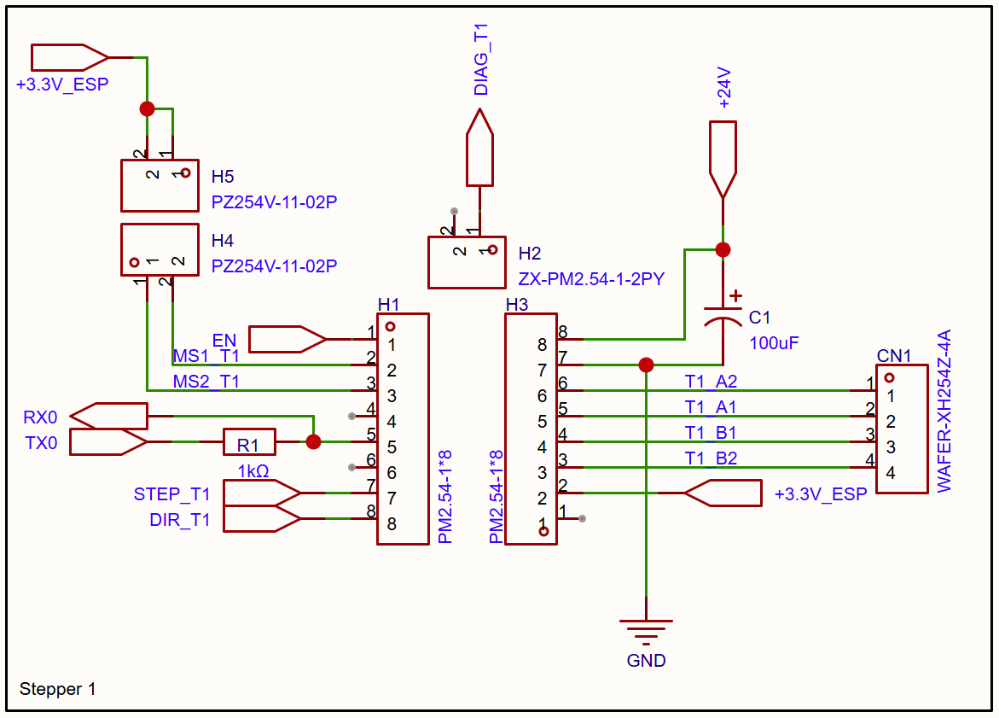
</p>

Der letzte Bestandteil des Schaltplans ist der Anschlusspunkt des Servomotors. Die Motorkabel des Servos werden über den Steckverbinder `CN5` mit dem PCB verbunden. Die 5-V-Versorgungsspannung wird erneut über die DC-DC-Converter-Schaltung bereitgestellt. Da der Servomotor über ein PWM-Signal angesteuert wird, ist der dritte Pin des Steckverbinders mit dem `S_PWM` des ESP32 verbunden.
 
<p align="center">
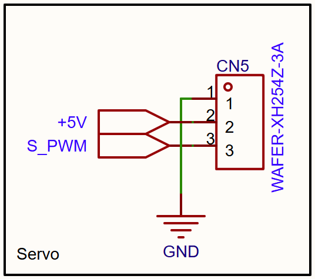
</p>

### PCB-Layout
 
Um die Produktionskosten des PCBs möglichst gering zu halten und weil die Komplexität des Aufbaus es nicht erfordert, wurde entschieden, ein zweilagiges PCB zu erstellen. Die zwei Lagen sollen dabei hauptsächlich zwei unterschiedliche Aufgaben erfüllen. Die Oberseite des PCBs (`Layer 1`) soll hauptsächlich für die Führung und Übertragung der einzelnen Steuersignale zwischen ESP32 und Motoren zuständig sein. Auf der Rückseite des PCBs (`Layer 2`) werden alle Spannungsleitungen (24 V, 5 V und 3,3 V) geführt. Damit die Bestückung des PCBs einfach gehalten werden kann, sind zudem alle Komponenten auf der Oberseite positioniert.
 
<p align="center">
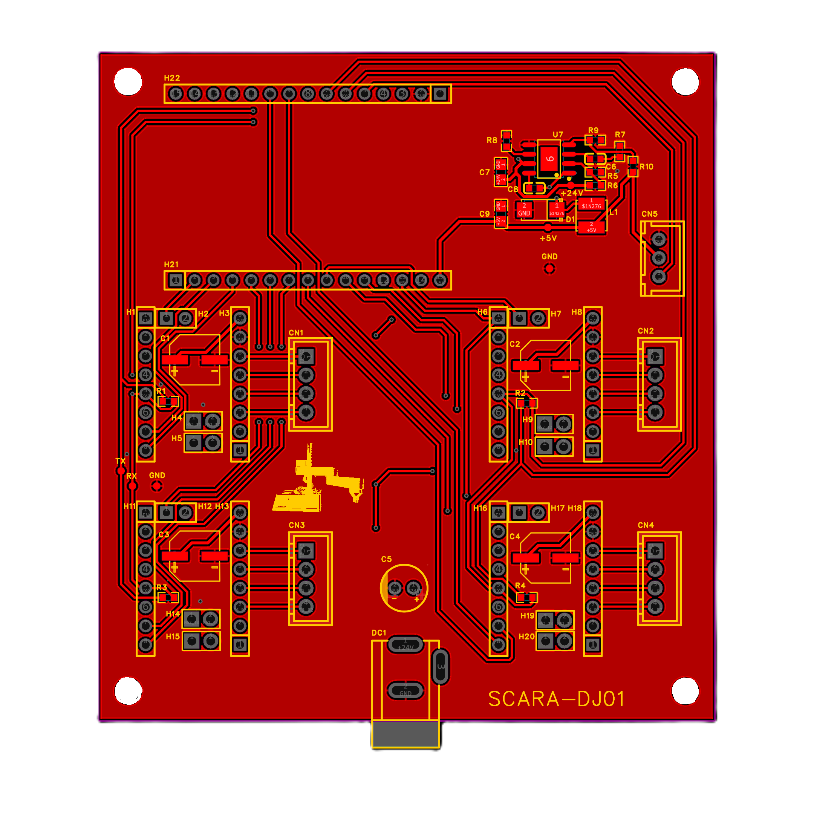
</p>

<p align="center">
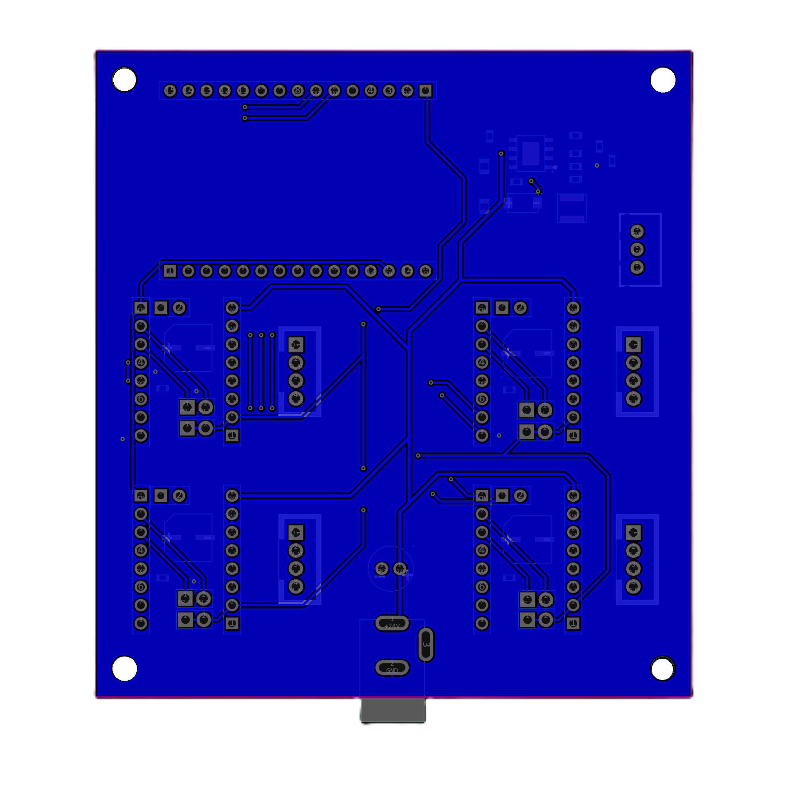
</p>

Das Layout des PCBs ist in vier große Teile aufgeteilt. Bereich 1 beinhaltet den 24-V-DC-Power-Jack, Bereich 2 sind die Steckplätze der TMC2209-Treiber sowie die Anschlussstecker der Motorkabel, Bereich 3 beinhaltet den Steckplatz des ESP32-Devkits, welcher die zentrale Steuerung des Roboters ist, und Bereich 4 beinhaltet die DC-DC-Converter-Schaltung von 24 V auf 5 V. 
 
<p align="center">
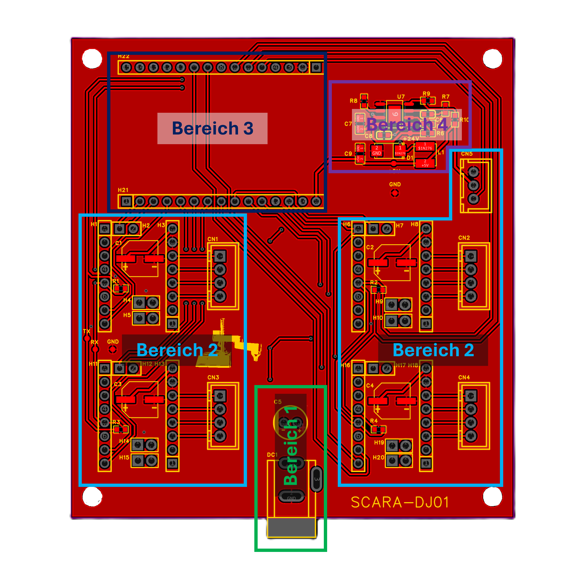
</p>

Das 24-V-Netz wird vom DC-Power-Jack, welcher auf der unteren Seite des PCBs positioniert ist, über den Stützkondensator sternförmig zu den Treibern und der Converter-Schaltung geleitet. Da die einzelnen Treiber ebenfalls über Stützkondensatoren verfügen, wird durch die sternförmige Führung des 24-V-Netzes verhindert, dass sich diese Kondensatoren gegenseitig belasten. 
 
Jeder Treibersteckplatz verfügt über die Headerpins für das Einstecken der Treiber, das Festlegen der UART-Adresse und das Anschließen der Motorkabel. Der Kondensator zum Stützen der 24-V-Versorgungsspannung ist jeweils unter den Treibern angebracht. 
 
Der Steckplatz des ESP32-Devkits befindet sich im oberen linken Bereich des PCBs. Von hier aus werden alle Signalleitungen weitestgehend gebündelt zu den Treibern und dem Servomotor geführt. Die `TX0`- und `RX0`-Leitungen werden am Rand des PCBs geführt, von wo sie dann mit den entsprechenden Pins der Treiber verbunden werden.
 
Die DC-DC-Converter-Schaltung ist im oberen rechten Teil des PCBs positioniert. Da lediglich der ESP32 und der Servomotor eine Versorgungsspannung von 5 V benötigen, ist die Converter-Schaltung genau zwischen diesen beiden Bauelementen positioniert. Somit muss das 5-V-Netz nicht über das gesamte PCB geroutet werden.
 
An allen vier Ecken des PCBs sind zudem **Bohrungen** mit einem Durchmesser von 3,2 mm positioniert. Diese ermöglichen es, das PCB im Gehäuse des SCARA-Roboters mittels Schrauben sicher zu befestigen.
 
Für die Überprüfung der Versorgungsspannungen (24 V und 5 V) sowie das Debuggen der UART-Kommunikation wurden auf den entsprechenden Leitungen **Testpads** mit einem Durchmesser von 1 mm positioniert. Die Testpunkte sind entsprechend ihrer Signale auf dem Silkscreen gekennzeichnet. 
 
Die Traces des PCBs haben eine standardmäßige Breite von 3 mm. Aufgrund der höheren Ströme auf den Traces des 24-V- und 5-V-Netzes sind diese Traces mit einer Breite von 4 mm dimensioniert. Für die beiden Netze ergeben sich dabei die folgenden Strombelastbarkeitswerte:
 
<p align="center">

| Net | Net-Länge | Trace-Breite | Widerstand | Strombelastbarkeit | 
|:---:|:---:|:---:|:---:|:---:|
| 24 V | 239 mm | 3 mm | 0,2936 Ω | **1,23 A** |
| 5 V | 49 mm | 3 mm | 0,0602 Ω | **1,23 A** | 

</p>

Da der Nennstrom der beiden Netze nie einen Wert von mehr als 1 A erreicht, sind diese somit ausreichend groß dimensioniert.
 
Um die verschiedenen Traces voneinander zu schirmen und eine bessere EMV zu gewährleisten, wurde sowohl auf der Oberseite (`Layer 1`) als auch auf der Unterseite (`Layer 2`) ein sogenannter GND-Pour hinzugefügt. Dieser füllt alle freien Flächen zwischen Traces und Komponenten mit Kupfer und ist dabei mit dem GND-Netz verbunden. So können die einzelnen Signal- und Spannungsleitungen voneinander geschirmt werden und gleichzeitig ein niederohmiger Rückleitungspfad gewährleistet werden.

### Bestückung und Fertigung

Da es sich bei EasyEDA um ein Programm des Leiterplattenherstellers **JLCPCB** handelt, wurde das PCB ebenfalls über diesen Hersteller bestellt. Über EasyEDA kann das PCB dabei direkt an den Onlineshop des Herstellers übertragen und anschließend bestellt werden. Alle Komponenten wurden separat beim Lieferanten **LCSC** bestellt. Die BOM, die Gerber-Dateien und alle weiteren Dateien sind im Verzeichnis [proj/Export/Prototyp](proj/Export/Prototyp) zu finden.

Die Bestückung des PCBs mit den Komponenten erfolgte mittels einer **Heißluftlötstation** sowie eines normalen **Lötkolbens**. Für das Löten der SMD-Bauteile wurde Lötpaste mittels einer Spritze auf die Kontakte aufgetragen und anschließend mit der Heißluftlötstation erhitzt. Danach wurden alle Through-Hole-Komponenten mit dem Lötkolben auf dem PCB verlötet.

### Testversuche

Mit der fertiggestellten Prototypen-Leiterplatte wurden mehrere Testversuche durchgeführt, um die korrekte Funktionsweise des PCBs zu validieren.

**Testversuch 1 (Betrieb eines Schrittmotors): ✅❌**

Für diesen Testversuch wurde ein TMC2209-Treiber auf dem Treibersteckplatz `T1` installiert und über den ESP32 angesprochen. Der Programmcode steuerte den Schrittmotor dabei so an, dass sich dieser mit einer konstanten Geschwindigkeit für 3 Sekunden im Rechtslauf und anschließend 3 Sekunden im Linkslauf dreht.

Dieses Verhalten konnte nicht validiert werden auf Steckplatz `T1` konnte der Schrittmotor nicht angesprochen werden. Treiber auf allen anderen Steckplätzen (`T2` bis `T4`) konnten jedoch erfolgreich angesprochen werden, wodurch der Test als nur **teilweise bestanden** geschlossen werden konnte.

**Testversuch 2 (Betrieb von zwei Schrittmotoren): ✅**

Für diesen Testversuch wurden zwei TMC2209-Treiber auf den Steckplätzen `T2` und `T3` installiert und durch den ESP32 angesprochen. Der Programmcode steuerte dabei beide Motoren gleichzeitig an. Beide Motoren sollten sich mit einer konstanten Geschwindigkeit erneut für 3 Sekunden im Rechtslauf und anschließend 3 Sekunden im Linkslauf drehen.

Dieses Verhalten konnte erfolgreich validiert werden, sodass dieser Test ebenfalls mit dem Status **erfolgreich bestanden** geschlossen werden konnte.

**Testversuch 3 (Ansteuerung der TMC2209-Treiber über UART): ❌**

Für diesen Testversuch wurden zwei Treiber auf den Steckplätzen `T2` und `T3` installiert. Über die Header für das Setzen von `MS1` und `MS2` wurde die UART-Adresse des ersten Treibers auf 0 (`MS1` und `MS2` auf `GND`) und die Adresse des zweiten Treibers auf 1 (`MS1` auf `3,3 V` und `MS2` auf `GND`) festgelegt. Über den ESP32 wurden die Treiber so angesprochen, dass sich beide Motoren mit der gleichen Geschwindigkeit drehen. Motor 1 soll sich dabei 3 Sekunden im Rechtslauf und anschließend 3 Sekunden im Linkslauf drehen. Motor 2 soll sich wiederum 6 Sekunden im Rechtslauf und anschließend 6 Sekunden im Linkslauf drehen.

Dieses Verhalten konnte nicht validiert werden. Motor 2 drehte sich beim Test mit einer deutlich langsameren Geschwindigkeit, was darauf hindeutet, dass der Treiber keine UART-Kommunikation aufbauen konnte. Dadurch werden `MS1` und `MS2` zum Einstellen der Mikroschritte verwendet, was das langsamere Drehen des Motors erklären würde. Über das Auslesen des seriellen Monitors konnte ebenfalls keine funktionierende UART-Kommunikation validiert werden.

**Testversuch 4 (Auslesen des DIAG-Signals): ❌**

Für diesen Testversuch wurde ein TMC2209-Treiber auf dem Steckplatz `T2` installiert und durch den ESP32 angesprochen. Dabei wurde versucht, das DIAG-Signal beim Blockieren der Motorwelle auszulesen. 

Hierfür wurde der Motor mit einer konstanten Geschwindigkeit gedreht und durch Festhalten der Motorwelle blockiert. Dabei konnte über den seriellen Monitor kein DIAG-Signal durch den Treiber validiert werden, wodurch dieser Test als **nicht bestanden** geschlossen werden konnte.

**Testversuch 5 (Ansteuerung des Servomotors): ❌✅**

Für diesen Testversuch wurde der Servomotor mit dem PCB verbunden und über den ESP32 angesprochen. Der Servomotor sollte sich dabei einmal von der linken Endlage zur rechten Endlage drehen.


**Hier noch weiter schreiben**

Durch das Nichtbestehen der Versuche 1, 3 und 4 konnte die korrekte Funktionsweise des Prototyps nicht validiert werden. Das Fehlverhalten gilt es im finalen PCB zu beheben.


## Finales PCB-Design

Ziel des finalen PCB-Designs war es, das Fehlverhalten des Prototyps zu beheben, sodass das PCB im SCARA-Roboter DJ01 wie gewünscht verwendet werden kann.

### Änderungen des Schaltplans

Das Fehlverhalten des PCBs in Testversuch 1 deutet darauf hin, dass die `STEP_T1`- oder `DIR_T1`-Leitung nicht korrekt am Treiber angeschlossen ist oder auf falschen Kanälen des ESP32-Devkits liegt. Da die Treiber auf allen weiteren Steckplätzen angesprochen werden konnten, spricht dies gegen eine falsche Belegung der Treiberpins. Nach erneutem Betrachten des Pinouts des ESP32-Devkits fällt auf, dass die Leitungen `STEP_T1` und `DIR_T1` mit `GPIO39` und `GPIO34` des ESP32-Devkits verbunden sind. Hierbei handelt es sich nach weiterer Recherche um Input-only-Pins.

<p align="center">
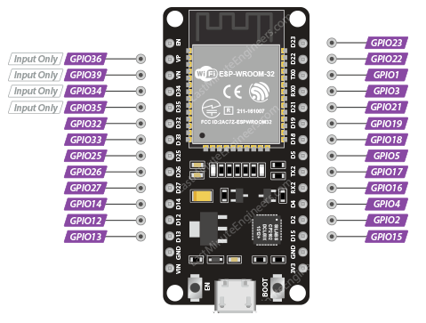
</p>

Da jedoch sowohl `STEP_T1` als auch `DIR_T1` Ausgangssignale des ESP32 sind, können diese demnach nicht an den Treiber auf dem ersten Steckplatz übertragen werden. Das Problem kann also dadurch behoben werden, dass die beiden Signalleitungen an zwei neue Pins angeschlossen werden, welche für Ausgangssignale geeignet sind. Auf dem finalen PCB liegt `STEP_T1` an `GPIO23` und `DIR_T1` an `GPIO22`. Diese Änderung wurde ebenfalls im Schaltplan des finalen PCBs übernommen. 

<p align="center">
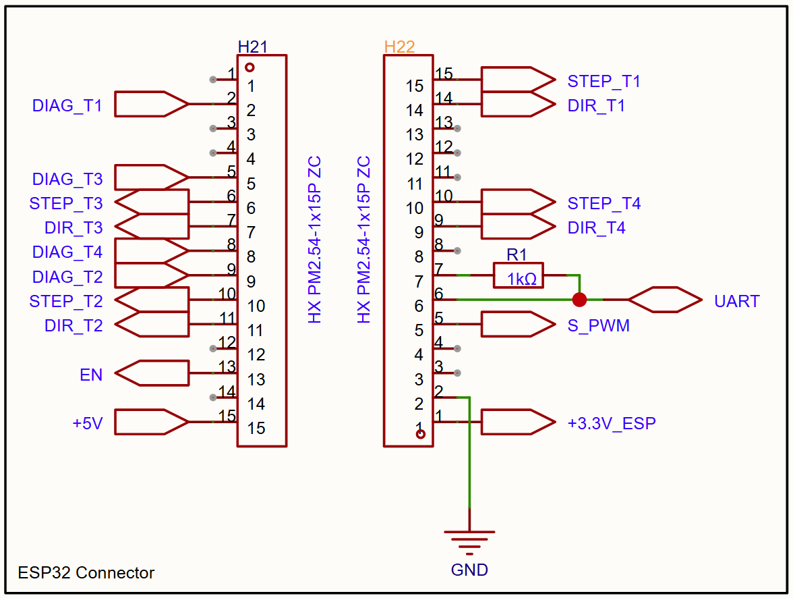
</p>

Das Fehlverhalten aus Testversuch 3 deutet darauf hin, dass keine erfolgreiche UART-Verbindung mit den einzelnen Treibern aufgebaut werden konnte. Nach erneuter Prüfung des Datenblattes der TMC2209-Treiber fällt auf, dass auf dem Prototyp-PCB die Verbindung der `TX0`- und `RX0`-Leitungen nicht korrekt durchgeführt wurde. Die korrekte Verschaltung der Treiber für die UART-Kommunikation ist in der nachfolgenden Abbildung dargestellt. 

<p align="center">
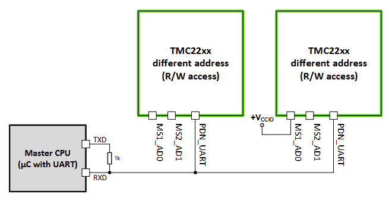
</p>

Nach diesem Verbindungsschema muss nicht jeder Treiber einzeln über einen eigenen 1-kΩ-Widerstand mit der `RX0`- und `TX0`-Leitung verbunden werden. Es müssen lediglich einmal die `TX0`- und `RX0`-Leitung über einen 1-kΩ-Widerstand am Mikrocontroller miteinander verbunden werden. Die dadurch entstehende `UART`-Leitung muss dann an die UART-Pins der Treiber weitergeleitet werden. Die Verschaltung der `TX0`- und `RX0`-Leitungen am Mikrocontroller wurde ebenfalls im Schaltplan angepasst. Bei erneuter Überprüfung der UART-Pins der Treiber fällt zudem auf, dass das UART-Signal am `TX`-Pin der Treiber und nicht wie gefordert am `RX`-Pin angeschlossen ist. Um eine erfolgreiche UART-Kommunikation zu gewährleisten, wurde die neue `UART`-Leitung an den `RX`-Pin der Treiber angeschlossen. Die neue Pinbelegung der Treiber ist symbolisch anhand des Steckplatzes für `T1` in der nachfolgenden Abbildung dargestellt.

<p align="center">
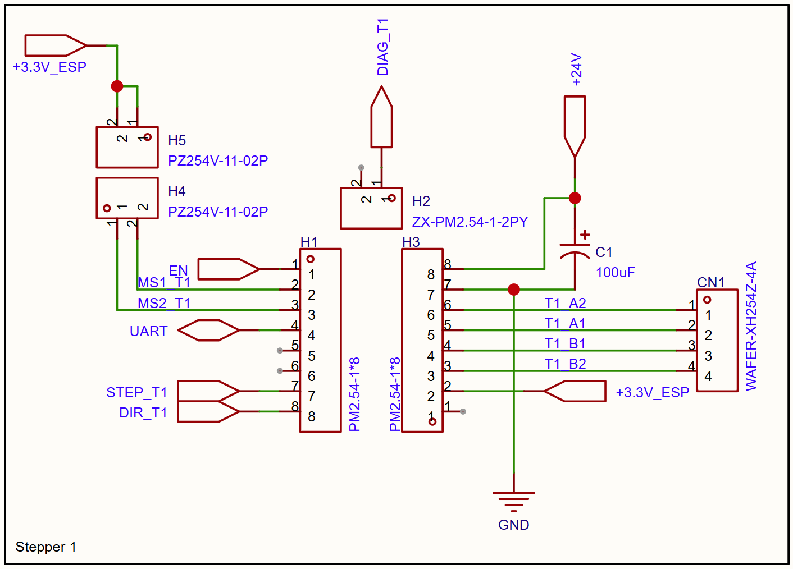
</p>

Das Fehlverhalten aus Testversuch 4 deutet darauf hin, dass die `DIAG`-Pins nicht korrekt mit den Treibern oder dem ESP32 verbunden sind. Da es sich bei den `DIAG`-Signalen um reine Eingangssignale am ESP32 handelt und diese mit dafür geeigneten GPIOs verbunden sind, kann das Fehlverhalten nicht durch die Verbindung am ESP32-Devkit hervorgerufen werden. Demnach muss eine falsche Verbindung am Treiber für das Fehlverhalten verantwortlich sein. Jedoch ist auch die Verbindung an den Steckplätzen der Treiber korrekt. Demnach liegt der Fehler nicht im Schaltplan, sondern im PCB-Layout selbst.

### Änderungen des PCB-Layouts

Bei näherem Betrachten des Layouts der Treibersteckplätze fällt auf, dass die Header `H2`, `H7`, `H12` und `H17` um **180°** falsch gedreht sind. So ist der Header-Pin, welcher eigentlich mit dem `DIAG`-Pin der Treiber verbunden sein sollte, mit dem `INDEX`-Pin der Treiber verbunden. Der eigentliche `DIAG`-Pin selbst wird jedoch nicht kontaktiert.

<p align="center">
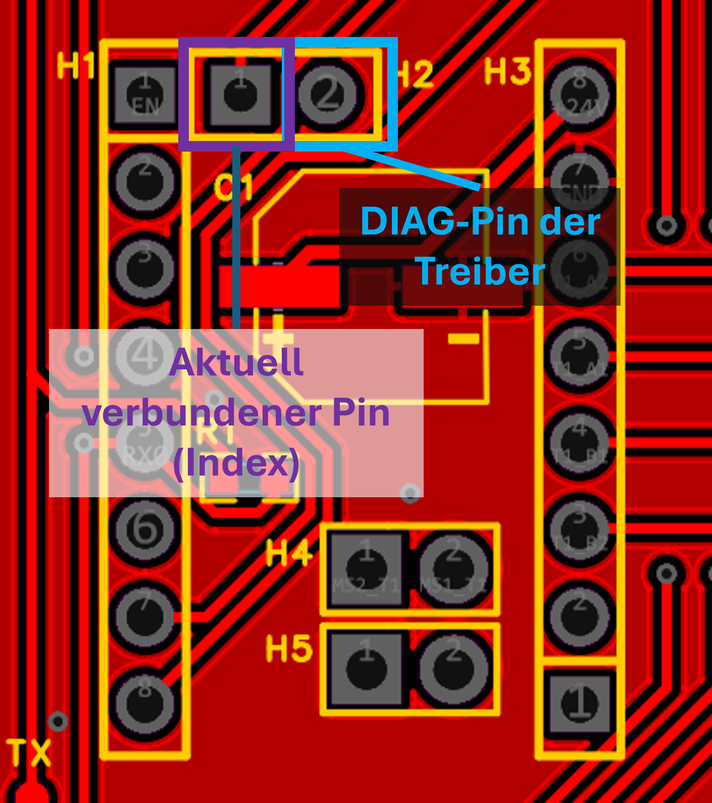
</p>

Diese fehlende Kontaktierung des `DIAG`-Pins würde erklären, warum keine Signale durch den ESP32 empfangen werden und kein sensorloses Homing möglich ist. 

Auf Grundlage der Anpassungen im Schaltplan sowie der falschen Ausrichtung der Header wurde das PCB-Layout nochmals überarbeitet. Analog zum Prototyp ist das PCB in die vier großen Bereiche aufgeteilt. Die Oberseite `Layer 1` führt erneut die Steuerleitungen und die Unterseite `Layer 2` die Spannungsleitungen. Verändert haben sich lediglich die kontaktierten Pins der Treiber (UART-Pins), die Rotation der Header, die Verschaltung der `RX0`- und `TX0`-Leitungen und die Anschlusspins für `STEP_T1` und `DIR_T1` am ESP32-Devkit. Der neue 1-kΩ-Widerstand für die UART-Leitung ist nun unter dem Steckplatz des ESP32-Devkits positioniert. Da die `TX0`- und `RX0`-Leitungen jedoch nicht mehr über das gesamte PCB laufen, mussten die entsprechenden Testpads ebenfalls neben dem Steckplatz des ESP32 positioniert werden. Da beim Layout des Prototyp-PCBs die Abstände zwischen den einzelnen Headern nicht exakt mit den Abständen der Pin-Reihen der Bauelemente übereingestimmt haben, wurden diese Abstände im finalen Layout ebenfalls überarbeitet. Das [finale PCB-Layout](proj/EASY%20EDA/Finales%20Design/ProPrj_Scara%20Robot%20PCB_2026-11-23.epro2) ist in den nachfolgenden Abbildungen zu erkennen.

<p align="center">

</p>

<p align="center">

</p>

Die vollständigen Fertigungsdateien des finalen PCBs sind im Verzeichnis [proj/Export/Finales Design](proj/Export/Finales%20Design/) abgelegt. 

### Bestückung und Fertigung

Das finale PCB wurde aus zeitlichen Gründen nicht bestellt und daher auch nicht bestückt. Dies soll jedoch in einem späteren Arbeitsschritt in Kombination mit der Durchführung der gleichen Testversuche wie beim Prototyp erfolgen.

## Erkenntnisse und Learnings